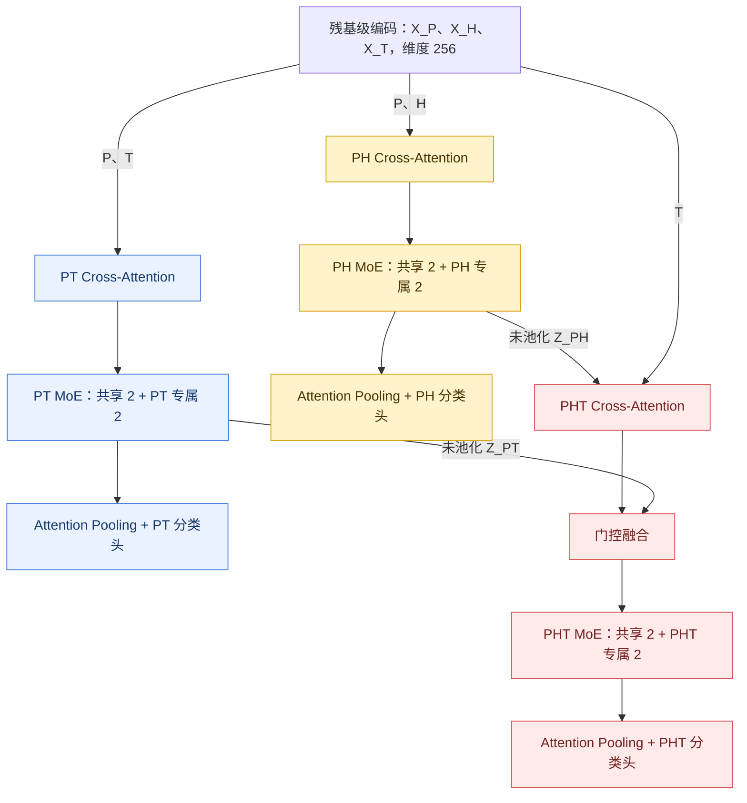

# MoE模型架构优化

**User:** Anonymous  
**Created:** 10/26/2026 20:41:03  
**Updated:** 10/26/2026 20:48:14  
**Exported:** 10/27/2026 16:06:30  
**Link:** [https://chatgpt.com/c/6adf4a45-f8cc-83ec-acc7-090b9df40f1e](https://chatgpt.com/c/6adf4a45-f8cc-83ec-acc7-090b9df40f1e)  

## Prompt:
2026/10/26 20:40:41

以我的模型为基础，采用MoE的思想与架构进行优化，详细设计模型架构和训练方式，任务还是做PH，PT和PHT的分类预测任务

## Response:
2026/10/26 20:41:16 · gpt-6-pro

我会先查看你上传的模型图，梳理 PH、PT、PHT 三个任务的特征交互与共享关系，再设计 MoE 专家、路由机制和训练方案，并结合相关论文核对这些选择的依据。

图中最值得保留的是 PH 分支把未池化的 pHLA 表征传给 PHT 分支，这为三元预测提供了明确的 HLA 条件信息。我的设计会把 MoE 放在交互特征层，让三个任务按样本选择共享专家和分支专家；同时让 PHT 利用 PT 的中间特征，并保证单独预测 PH 时只需要 P、H，预测 PT 时只需要 P、T。

训练方案中需要特别处理两点：PHT 阴性不能自动当作 PH、PT 阴性，缺失标签必须单独屏蔽；部分公开 TCR-BERT 权重还做过抗原分类训练，评估“未见肽”时要核查是否有监督信息重叠。我也会加入等参数量 FFN、固定专家权重和去掉 PT→PHT 连接的对照，以判断收益是否确实来自 MoE 路由。

> **已搜索 49 个网站**
>
> 
>
> **已搜索 12 个网站**
>
> 
>
> **Organizing code presentation**
>
> I’m considering the best way to present the code. It seems like saving all code might be excessive, especially if we can include a textual list of algorithms instead. I think it would be helpful to mention the head-level MoE baseline and the rationale behind design choices if the user is curious. I’ll structure the final plan with an intro and a series of recommended sections, focusing on clarity and optimizing information without overwhelming the user.
>
> **Clarifying project goals**
>
> I’m considering structuring my response with subsections and detailed math using LaTeX, along with tables and citations. I want to avoid external references and focus on our original design needs. My plan is to suggest a first implementation with a specific configuration and workflow, ensuring I follow the guidelines about summarizing.
> 
> The Chinese character count will be around 14,000, giving me enough tokens while aiming for clarity. I need to be concise, keeping to the requirements while balancing thoroughness with efficiency. I'll keep my citations focused for budget reliability.
>
> **整理代码展示并明确项目目标**
>
> 
>
> **已搜索 13 个网站**
>
> 
>
> 思考了 4m 58s

**基于你这张模型图，我建议采用“交互层 MoE + 多任务门控 + 分层特征复用”的方案：保留现有的 PH、PT、PHT 三条 Cross-Attention 路径，在每条路径的交互特征上加入“共享专家 + 分支专属专家”，再由各任务自己的门控网络，根据当前样本选择专家组合。**

其中，PHT 继续使用 PH 分支生成的 pHLA 表征，并增加一条**受门控控制的 PT→PHT 特征连接**，利用 PT 分支学到的识别信息。

第一版建议采用以下配置：

- 保留 ESM-C、TCR-BERT，以及统一到 256 维的编码层。
- 设置 **2 个共享专家 + 每个任务 2 个分支专家，共 8 个专家**。
- 每个分支从“2 个共享专家 + 自己的 2 个专家”中进行加权组合。
- 使用**样本级 Softmax 门控**，先完成稠密 MoE 训练。
- 保留三个独立的二分类头，使用带标签掩码的多任务联合训练。
- 把 Top-2 稀疏路由作为后续对照实验。

这套方案借鉴了 MMoE 的“各任务拥有独立门控”和 PLE 的“区分共享与任务特定成分”两项思想，再针对你模型中不同任务的输入范围、PH→PHT 依赖关系进行修改。下面的架构和超参数属于针对你模型提出的设计方案，性能提升需要通过实验验证。([research.google](https://research.google/pubs/modeling-task-relationships-in-multi-task-learning-with-multi-gate-mixture-of-experts/?utm_source=chatgpt.com), [recsys.acm.org](https://recsys.acm.org/recsys20/session-4/?utm_source=chatgpt.com))

---

# 一、先明确你当前模型中值得保留和需要增强的部分

## 1. 当前模型已经包含有效的层级关系

根据你上传的图，三个分支可以写成：

$$
Z_{PH}
=
\operatorname{CrossAttention}(Q=P,\ K=H,\ V=H)
$$

$$
Z_{PT}
=
\operatorname{CrossAttention}(Q=P,\ K=T,\ V=T)
$$

$$
Z_{PHT}
=
\operatorname{CrossAttention}(Q=Z_{PH},\ K=T,\ V=T)
$$

随后各分支进行 Attention Pooling 和分类。

这里很有价值的一点是：

> **PHT 的输入已经包含 PH 交互结果，因此三元预测能够利用“肽在特定 HLA 条件下的表征”。**

这条连接应该保留，而且应当继续传递**未池化的残基级特征**。

假设肽长度为 $L_P$，则：

$$
Z_{PH}\in\mathbb{R}^{B\times L_P\times256}
$$

不要先把它压缩为：

$$
\mathbb{R}^{B\times256}
$$

再传入 PHT。保留 $L_P$ 这一维，后续交互层才可以分别处理不同肽残基。

## 2. MoE 主要解决三个问题

| 当前模型可以增强的方面 | 引入 MoE 后的处理方式 |
|---|---|
| 同一分支中的样本经过同一组特征变换参数 | 根据样本内容，调整不同专家的贡献 |
| 三个任务主要依靠共享编码器实现知识共享 | 在交互特征层增加可学习的共享机制 |
| 不同任务可能出现负迁移 | 通过共享专家与分支专家分工，保留各任务需要的特定变换 |

另外，你图中的 PT 特征没有直接进入 PHT。可以增加这条连接，但应当把它作为一个独立改动进行消融，因为“增加 PT 特征”和“增加 MoE”可能分别贡献收益。

---

# 二、三个任务的定义，决定了专家和路由器能看到什么

建议首先固定如下任务语义：

| 任务 | 输入 | 分类目标 | 本次预测允许使用的信息 |
|---|---|---|---|
| PH | Peptide、HLA | 给定实验定义下的肽-HLA 结合 | P、H |
| PT | Peptide、TCR | HLA 未作为显式输入时的肽-TCR 识别关联 | P、T |
| PHT | Peptide、HLA、TCR | TCR 是否识别指定的 pHLA | P、H、T |

三个输出分别为：

$$
\hat y_{PH}=\sigma(s_{PH}),\qquad
\hat y_{PT}=\sigma(s_{PT}),\qquad
\hat y_{PHT}=\sigma(s_{PHT})
$$

**这里使用三个独立的 Sigmoid，不能把 PH、PT、PHT 当成互斥类别做三分类 Softmax。**

还需要明确 PT 的含义：对于这里讨论的常规 TCR-pHLA 识别问题，HLA 是生物学背景的一部分。PT 任务省略了 HLA 输入，因此输出会受到训练数据中 HLA 背景分布的影响。UniPMT 也将 PH、PT、PHT 对应的三类关系纳入统一预测框架，但这不意味着 PT 能完整描述不依赖 HLA 的识别过程。([nature.com](https://www.nature.com/articles/s42256-025-01002-0?utm_source=chatgpt.com))

这对架构有一个直接约束：

> **PH 的门控网络只能读取 P、H 及它们的交互特征；PT 的门控网络只能读取 P、T 及它们的交互特征。**

即使训练时某条记录拥有完整 P、H、T，也应当保持这两个分支的输入边界。共享权重可以接受不同任务的训练信号，但单次 PH 推理不应依赖额外的 TCR 输入。

---

# 三、推荐的完整模型架构

下面这张图中，三个 MoE 模块共用同一组共享专家；各自的分支专家和门控网络保持独立。

这个设计有两个层次：

1. **任务内部的自适应计算**：不同样本使用不同专家权重。
2. **任务之间的分层共享**：共享专家传递共性知识，PH、PT 的中间特征共同支持 PHT。

下面逐个展开。

---

# 四、第一层：保留预训练编码器，统一残基级表示

## 4.1 输入和输出维度

按照你图中的维度：

$$
E_P=\operatorname{ESM\text{-}C}(P)
\in\mathbb{R}^{B\times L_P\times960}
$$

$$
E_H=\operatorname{ESM\text{-}C}(H)
\in\mathbb{R}^{B\times L_H\times960}
$$

$$
E_T=\operatorname{TCR\text{-}BERT}(T)
\in\mathbb{R}^{B\times L_T\times768}
$$

再通过各模态自己的投影与编码层：

$$
X_P=\operatorname{Encoder}_P(E_P)
$$

$$
X_H=\operatorname{Encoder}_H(E_H)
$$

$$
X_T=\operatorname{Encoder}_T(E_T)
$$

统一得到：

$$
X_P\in\mathbb{R}^{B\times L_P\times256}
$$

$$
X_H\in\mathbb{R}^{B\times L_H\times256}
$$

$$
X_T\in\mathbb{R}^{B\times L_T\times256}
$$

这里建议：

- HLA 与 peptide 可以复用同一份 ESM-C 参数，分别编码。
- HLA、peptide、TCR 的投影层分别设置。
- 三个任务共用同一份 peptide 表征 $X_P$。
- 保留残基维度，正确排除 padding 和特殊 token。
- 第一阶段冻结预训练编码器，训练投影层及后续网络。

你图中的 TCR-BERT 768 维与作者公开权重配置一致。不过，公开模型的最大位置长度是 64；若以后输入完整 TCR 可变区或拼接较长的 α、β 链，需要调整编码方案，不能直接按短 CDR3 的方式截断处理。([huggingface.co](https://huggingface.co/wukevin/tcr-bert/blob/main/config.json?utm_source=chatgpt.com), [huggingface.co](https://huggingface.co/wukevin/tcr-bert-mlm-only/blob/main/config.json?utm_source=chatgpt.com))

## 4.2 为什么第一版将 MoE 放在 Cross-Attention 后面？

| MoE 放置位置 | 特点 | 对你当前模型的建议 |
|---|---|---|
| 预训练编码器内部 | 修改范围大，会改变原有表征学习过程 | 后续再研究 |
| Cross-Attention 后、Pooling 前 | 专家处理已经包含分子交互的残基特征 | **主方案** |
| Pooling 后、分类头前 | 实现简单，计算量较小 | 适合作为轻量对照 |
| 三个最终分类结果之间 | 主要是在融合预测分数 | 难以充分利用残基级交互信息 |

你的三个分支都以肽或肽条件化表征作为 Query，因此它们的输出都能保留 $L_P$ 个位置。这使得**以肽残基位置为基础共享专家**比较自然。

---

# 五、第二层：设计共享专家、分支专家与门控网络

## 5.1 专家池：总共 8 个专家

建议第一版设置：

| 专家组 | 数量 | 直接调用它的 MoE 分支 |
|---|---:|---|
| 共享专家 $E^S_1,E^S_2$ | 2 | PH、PT、PHT |
| PH 分支专家 $E^{PH}_1,E^{PH}_2$ | 2 | PH |
| PT 分支专家 $E^{PT}_1,E^{PT}_2$ | 2 | PT |
| PHT 分支专家 $E^{PHT}_1,E^{PHT}_2$ | 2 | PHT |

因此，各分支的候选专家集合为：

$$
\mathcal E_{PH}
=
\{E^S_1,E^S_2,E^{PH}_1,E^{PH}_2\}
$$

$$
\mathcal E_{PT}
=
\{E^S_1,E^S_2,E^{PT}_1,E^{PT}_2\}
$$

$$
\mathcal E_{PHT}
=
\{E^S_1,E^S_2,E^{PHT}_1,E^{PHT}_2\}
$$

**共享专家必须是同一份参数，在三个分支中复用。** 如果分别创建三套结构相同的网络，就没有实现参数共享。

这里的“分支专属”描述的是**直接调用范围**。由于 $Z_{PH}$、$Z_{PT}$ 会进入 PHT，PHT 损失仍然可以沿着这些连接更新 PH、PT 分支专家。

## 5.2 每个专家使用什么网络？

第一版采用相同结构、独立参数的 FFN：

$$
E_j(z)
=
W_{2,j}\,
\operatorname{GELU}(W_{1,j}z+b_{1,j})
+b_{2,j}
$$

维度：

$$
256\rightarrow512\rightarrow256
$$

专家逐残基作用，因此：

$$
E_j:
\mathbb{R}^{B\times L_P\times256}
\rightarrow
\mathbb{R}^{B\times L_P\times256}
$$

8 个这样的专家约有 **210 万参数**，这里仅计算专家 FFN，不包含路由器、注意力层、分类头和预训练编码器。

不建议一开始人为规定“某个专家专门学习疏水作用，另一个专家专门学习氢键”。分类监督不会自动保证这些解释成立。更合理的做法是让专家自主分化，训练完成后再用分组分析和扰动实验检查它们是否形成可解释的偏好。

## 5.3 每个任务拥有自己的门控网络

对任务 $t$，门控权重为：

$$
g_t(c_t)
=
\operatorname{Softmax}
\left(
\frac{\operatorname{MLP}^{gate}_t(c_t)}{\tau}
\right)
$$

其中：

- $c_t$：当前样本的任务相关上下文；
- $g_t\in\mathbb{R}^{B\times4}$：四个可访问专家的权重；
- $\tau$：门控温度；
- 每个任务拥有独立的 $\operatorname{MLP}^{gate}_t$。

例如，某个 PH 样本的门控可能为：

$$
g_{PH}=[0.10,\ 0.15,\ 0.60,\ 0.15]
$$

另一个 PH 样本可能为：

$$
g_{PH}=[0.35,\ 0.35,\ 0.10,\ 0.20]
$$

这些数值只是说明机制：第一个样本更多使用 PH 分支专家，第二个样本更多使用共享专家。

专家与门控网络都通过分类损失反向传播训练，**不需要给每条样本额外标注“应该交给哪个专家”。**

## 5.4 推荐从样本级门控开始

第一版：

$$
g_t\in\mathbb{R}^{B\times4}
$$

同一样本的所有肽残基共用一组专家权重，但专家仍然对每个残基的不同输入进行计算。

后续可以比较残基级门控：

$$
g_t\in\mathbb{R}^{B\times L_P\times4}
$$

| 门控粒度 | 优点 | 代价 |
|---|---|---|
| 样本级 | 路由结构较简单，便于分析任务和样本差异 | 一个样本内各位置共用专家比例 |
| 残基级 | 不同肽位置可以选择不同专家 | 路由自由度更大，需要更多证据验证其泛化 |

在你尚未提供训练样本数量和独立肽数量的情况下，我会优先选择样本级门控。

## 5.5 定义统一的 MoE 残差块

令 $U_t$ 是 Cross-Attention 后、MoE 前的表示，则：

$$
\operatorname{MoEBlock}_t(U_t,c_t)
=
U_t+
\operatorname{Dropout}
\left[
\sum_{j\in\mathcal E_t}
g_{t,j}(c_t)
E_j\big(\operatorname{LN}_t(U_t)\big)
\right]
$$

这里：

- $U_t$ 的残差连接保留原交互信息。
- $\operatorname{LN}_t$ 可以按分支分别设置。
- 门控权重在残基维度上广播。
- 混合的是**中间特征**，最终再由各任务分类头预测。

这相当于把普通 Transformer 块中的 FFN，替换成受任务和样本共同控制的专家组合。

---

# 六、三个任务的完整前向计算

为了简化公式，先定义带 Query 残差的交互模块：

$$
\operatorname{Cross}_t(Q,K)
=
Q+
\operatorname{Dropout}
\left[
\operatorname{MHA}_t
\big(
\operatorname{LN}(Q),
\operatorname{LN}(K),
\operatorname{LN}(K)
\big)
\right]
$$

三个分支的 Cross-Attention 参数分别设置。

## 6.1 PH 分支

先计算肽-HLA 交互：

$$
U_{PH}
=
\operatorname{Cross}_{PH}(X_P,X_H)
$$

设 $\overline X$ 表示排除 padding 后的平均池化，构造门控上下文：

$$
c_{PH}
=
[
\overline{U_{PH}};
\overline{X_P};
\overline{X_H}
]
$$

然后：

$$
Z_{PH}
=
\operatorname{MoEBlock}_{PH}(U_{PH},c_{PH})
$$

输出两个结果：

1. $Z_{PH}$ 送入 PH Pooling 和分类头；
2. 同一个未池化的 $Z_{PH}$ 作为 PHT 分支的输入。

即：

$$
v_{PH}
=
\operatorname{AttnPool}_{PH}(Z_{PH})
$$

$$
s_{PH}
=
\operatorname{MLP}_{PH}(v_{PH})
$$

## 6.2 PT 分支

同样：

$$
U_{PT}
=
\operatorname{Cross}_{PT}(X_P,X_T)
$$

$$
c_{PT}
=
[
\overline{U_{PT}};
\overline{X_P};
\overline{X_T}
]
$$

$$
Z_{PT}
=
\operatorname{MoEBlock}_{PT}(U_{PT},c_{PT})
$$

$$
v_{PT}
=
\operatorname{AttnPool}_{PT}(Z_{PT})
$$

$$
s_{PT}
=
\operatorname{MLP}_{PT}(v_{PT})
$$

PT 分支可以在没有 HLA 输入的情况下独立运行。

## 6.3 PHT 分支：保留 PH→PHT，再加入受控的 PT 特征

### 第一步：利用 pHLA 表征查询 TCR

$$
U_{PHT}
=
\operatorname{Cross}_{PHT}(Z_{PH},X_T)
$$

展开为：

$$
U_{PHT}
=
Z_{PH}
+
\operatorname{Dropout}
\left[
\operatorname{MHA}_{PHT}
(
\operatorname{LN}(Z_{PH}),
\operatorname{LN}(X_T),
\operatorname{LN}(X_T)
)
\right]
$$

**这里应当保留 $Z_{PH}$ 的 Query 残差。**

因为注意力输出来自对 TCR Value 的加权组合，显式保留 $Z_{PH}$ 有助于保留肽-HLA 条件信息。

### 第二步：门控注入 PT 特征

由于 PH、PT 都以 peptide 为 Query，所以：

$$
U_{PHT},Z_{PT}
\in\mathbb{R}^{B\times L_P\times256}
$$

两者可以按同一个肽残基位置进行融合。

先对 PT 特征进行尺度和空间变换：

$$
R_{PT}
=
W_{PT}\operatorname{LN}(Z_{PT})
$$

对第 $i$ 个肽位置，计算融合系数：

$$
\beta_i
=
\sigma
\left[
\operatorname{MLP}_{fusion}
\left(
[
\operatorname{LN}(U_{PHT,i});
\operatorname{LN}(Z_{PT,i});
\overline{X_H}
]
\right)
\right]
$$

然后：

$$
\widetilde U_{PHT,i}
=
U_{PHT,i}
+
\beta_iR_{PT,i}
$$

第一版可以让每个位置只产生一个标量 $\beta_i$，控制该位置注入多少 PT 信息。融合门控的输出偏置可从 $-2$ 初始化，使训练开始时 PT 路径的贡献较小。

这里有两类不同的门控：

- $\beta$：控制 PHT 接收多少 PT 特征；
- $g_{PHT}$：控制 PHT 使用哪些专家。

两者都需要训练，权重也都不能直接解释为真实生物学贡献比例。

### 第三步：PHT 的专家混合

构造：

$$
c_{PHT}
=
[
\overline{\widetilde U_{PHT}};
\overline{X_P};
\overline{X_H};
\overline{X_T}
]
$$

然后：

$$
Z_{PHT}
=
\operatorname{MoEBlock}_{PHT}
(
\widetilde U_{PHT},
c_{PHT}
)
$$

$$
v_{PHT}
=
\operatorname{AttnPool}_{PHT}(Z_{PHT})
$$

$$
s_{PHT}
=
\operatorname{MLP}_{PHT}(v_{PHT})
$$

注意，所有路由上下文都来自**当前 MoE 之前的表示**，避免用 MoE 输出反过来生成同一个 MoE 的权重，造成循环定义。

### 需要验证的风险：PHT 是否绕过了 HLA？

PT→PHT 连接可能帮助迁移，也可能使 PHT 过度依赖 PT。

因此必须比较：

- 有、无 PT→PHT 连接的性能；
- 固定 P、T，改变 H 时模型输出的变化；
- 在有实验支持的 HLA 限制性样本上的表现。

HLA 置换带来的分数变化只能说明模型是否依赖 HLA，**正确性仍需要真实标签判断**。不能将任意 HLA 替换都当成真实阴性。

同时，当前主方案主要实现的是 **HLA 条件化的 peptide-TCR 交互**；仅把 HLA 摘要送入门控，还不能声称已经显式建模了 HLA-TCR 的所有残基接触。

## 6.4 三个分类头

各任务使用独立 Attention Pooling：

$$
a_{t,i}
=
\operatorname{Softmax}_i
\left(
w_t^\top\tanh(W_t Z_{t,i})
\right)
$$

$$
v_t=\sum_i a_{t,i}Z_{t,i}
$$

分类头可以设为：

$$
256\rightarrow128\rightarrow1
$$

训练时直接输出 logit，使用 `BCEWithLogitsLoss`；推理时再取 Sigmoid。

---

# 七、训练数据：分别处理输入缺失和标签缺失

这是整套方案能否正确训练的关键。

## 7.1 不要求每条样本同时具有三个标签

建议统一保存：

$$
(P,H,T,y_{PH},y_{PT},y_{PHT},m_{PH},m_{PT},m_{PHT})
$$

其中：

$$
m_t=
\begin{cases}
1,&\text{该任务标签有效且输入满足要求}\\
0,&\text{该任务不参与监督}
\end{cases}
$$

例如：

| 数据类型 | PH 监督 | PT 监督 | PHT 监督 |
|---|---:|---:|---:|
| 只有 P、H 及结合标签 | 1 | 0 | 0 |
| 只有 P、T 及识别标签 | 0 | 1 | 0 |
| 有 P、H、T，只有三元标签 | 0 | 0 | 1 |
| 三种关系均有可信测量 | 按实际标签 | 按实际标签 | 按实际标签 |

**输入缺失和标签缺失是两回事。**

- 没有 HLA 输入：不能执行 PH、PHT 分支。
- 有完整 PHT 输入，但没有 PH 标签：可以计算 PH 中间特征，只是不计算 PH 的监督损失。

后一种情况下，PHT 损失依然可以通过 $Z_{PH}$ 更新 PH 交互层。这是合法的特征学习过程。

## 7.2 PHT 阴性不能自动变成 PH、PT 阴性

例如：

- P 可以与 H 结合；
- T 不识别这个 pHLA；
- 因而 PHT 为负。

此时 PH 仍可能为正。

同样，某个 HLA 背景下的 PHT 阴性，也不能自动推断为 HLA 未指定时的 PT 阴性。

第一版建议仅使用原生、定义明确的标签。跨任务弱标签扩展可以单独研究，避免一开始把监督噪声混进 MoE 的效果评估。

也不建议默认强制：

$$
\hat y_{PHT}=\hat y_{PH}\hat y_{PT}
$$

因为这些头可能对应不同实验条件、不同标签阈值和不同条件概率。当前设计通过中间特征共享来建立联系，三个分类头分别学习自己的监督目标。

## 7.3 负样本要记录来源

至少区分：

1. 实验确认的阴性；
2. 同实验体系内测得的非响应；
3. 随机错配产生的合成阴性。

对于 PHT，可以优先考虑在固定 $(P,H)$ 的条件下替换 TCR，从而让模型学习 TCR 识别差异。不过，错配样本依然可能存在假阴性，需要保存其来源，单独评估其影响。

对于 PT，应尽量控制正负样本的来源、链组成和长度分布，避免模型只学会区分不同数据库。

这些问题已有直接的基准研究证据：负 TCR 来源会显著影响预测表现，外部来源的阴性可能引入混杂因素；IMMREP23 也报告了负例构造造成的数据偏差和未见肽泛化困难。([nature.com](https://www.nature.com/articles/s41592-025-02910-0?utm_source=chatgpt.com), [discovery.ucl.ac.uk](https://discovery.ucl.ac.uk/id/eprint/10205429/?utm_source=chatgpt.com))

---

# 八、损失函数：先保持简单，再针对问题增加约束

## 8.1 三任务监督损失

对任务 $t$：

$$
\mathcal L_t
=
\frac{
\sum_i m_{i,t}w_{i,t}
\,\operatorname{BCEWithLogits}(s_{i,t},y_{i,t})
}{
\sum_i m_{i,t}w_{i,t}+\epsilon
}
$$

其中 $w_{i,t}$ 可以表示样本权重；第一版在没有可靠置信度依据时，可以先统一取 1。

总监督损失：

$$
\mathcal L_{\mathrm{sup}}
=
\lambda_{PH}\mathcal L_{PH}
+
\lambda_{PT}\mathcal L_{PT}
+
\lambda_{PHT}\mathcal L_{PHT}
$$

如果三个任务同等重要，初始使用：

$$
\lambda_{PH}=\lambda_{PT}=\lambda_{PHT}=1
$$

如果研究目标明确以 PHT 为主，再依据验证集调整任务权重，并同时报告 PH、PT 是否退化。

实现时，如果缺失标签用 NaN 保存，应先索引有效标签再计算 BCE，避免先对 NaN 求损失、再乘零掩码。

## 8.2 轻量的专家使用正则

当一个任务长期几乎只使用一个专家时，可以加入弱正则。

对任务 $t$，先计算 batch 内平均门控：

$$
\bar g_{t,j}
=
\frac{1}{B_t}
\sum_i g_{t,j}(x_i)
$$

一种简单选择是：

$$
\mathcal L_{\mathrm{bal},t}
=
\sum_{j\in\mathcal E_t}
\left(
\bar g_{t,j}-\frac{1}{|\mathcal E_t|}
\right)^2
$$

总损失：

$$
\mathcal L
=
\mathcal L_{\mathrm{sup}}
+
\lambda_{\mathrm{bal}}
\sum_t\mathcal L_{\mathrm{bal},t}
$$

可从：

$$
\lambda_{\mathrm{bal}}\in\{0,10^{-3},10^{-2}\}
$$

进行小范围验证。

这里需要注意：

- 按每个任务自己的可访问专家集合统计。
- 正则作用于 batch 的平均分配。
- 保留单个样本具有明显专家偏好的自由。
- 共享专家和分支专家的真实最优使用比例未必均匀，因此正则应保持较弱。

对于稠密 MoE，这主要用于防止路由退化；它并不具有稀疏 MoE 中同样的设备负载含义。

## 8.3 发现梯度冲突后，再考虑 PCGrad

先监测共享参数上的任务梯度夹角：

$$
\cos(g_a,g_b)
=
\frac{g_a^\top g_b}
{\|g_a\|\|g_b\|}
$$

如果某些任务长期冲突，同时验证集表现出明显取舍，可以使用 PCGrad：

$$
g_a
\leftarrow
g_a-
\frac{g_a^\top g_b}
{\|g_b\|^2+\epsilon}g_b,
\qquad g_a^\top g_b<0
$$

PCGrad 通过处理冲突梯度缓解多任务优化干扰，但是否对你的数据有效，应当作为独立实验验证。([arxiv.org](https://arxiv.org/abs/2001.06782?utm_source=chatgpt.com))

处理范围应覆盖实际被多个损失更新的参数。除了共享编码器和共享专家，经 PHT 复用的 PH、PT 分支也可能处于多个损失的共同作用下。

---

# 九、推荐的训练流程

## 阶段 0：统一划分数据，再做训练准备

顺序建议为：

1. 统一 peptide、HLA、TCR 的标识和序列格式。
2. 合并重复监督记录，检查标签冲突。
3. 在三个任务之间统一建立训练、验证、测试划分。
4. 在划分内部构造合成负例。
5. 冻结预训练模型时，缓存独立序列的残基 embedding。

缓存的是：

$$
\operatorname{Encoder}_{LM}(P),\quad
\operatorname{Encoder}_{LM}(H),\quad
\operatorname{Encoder}_{LM}(T)
$$

交互层依赖多个输入，且需要训练，因此不应作为固定特征提前缓存。

## 阶段 1：冻结语言模型，联合训练全部新模块

训练：

- 模态投影层；
- 三个 Cross-Attention；
- 共享专家与分支专家；
- 三个专家门控；
- PT→PHT 融合模块；
- Pooling 和分类头。

我建议每个优化步骤分别取一个 PH、PT、PHT microbatch，例如每个任务 32 或 64 条：

$$
B_{\mathrm{step}}
=
B_{PH}\cup B_{PT}\cup B_{PHT}
$$

每个任务的损失分别求平均，再加权求和。

这样可以避免样本量最大的任务，仅因为数据条数多就主导所有参数更新。

专家应采用独立初始化。门控可以从较平缓的分配开始，例如温度由 2 逐渐降到 1，再观察是否形成稳定的样本差异。

如果已有训练好的原模型，可以利用对应分支的权重进行初始化，并把“从头训练”和“基线热启动”作为记录清楚的不同设置。

## 阶段 2：依据验证集决定是否微调语言模型

当新模块稳定后，再考虑：

- 解冻预训练模型顶部少量层；
- 或使用 LoRA 等参数高效微调方法。

语言模型学习率应明显低于新增模块，例如：

$$
\eta_{\mathrm{new}}=2\times10^{-4}
$$

$$
\eta_{\mathrm{LM}}=5\times10^{-6}\sim10^{-5}
$$

如果独立肽和独立 TCR 数量较少，完全冻结语言模型可能是更合适的选择，不必强制微调。

## 阶段 3：模型选择、阈值和校准

如果三个任务同等重要，可以预先规定：

$$
S_{\mathrm{val}}
=
\frac{
\operatorname{AUPRC}_{PH}
+
\operatorname{AUPRC}_{PT}
+
\operatorname{AUPRC}_{PHT}
}{3}
$$

作为一个模型选择指标，同时保留每个任务的单独结果。

如果 PHT 是主要研究目标，则明确以 PHT 为主指标，并预先规定 PH、PT 可接受的退化范围。

分类阈值和概率校准均在验证集确定，测试集用于最终评估。

## 推荐初始配置

以下是可执行的起点，不代表已在你的数据上优化过。

| 项目 | 初始设置 |
|---|---|
| 隐藏维度 | 256 |
| 每个 Cross-Attention 的头数 | 8 |
| 每条交互路径的块数 | 1 |
| 共享专家数 | 2 |
| 每分支专家数 | 2 |
| 专家结构 | $256\rightarrow512\rightarrow256$ |
| 专家门控粒度 | 样本级 |
| 专家门控隐藏层 | 128 |
| 路由方式 | 4 个候选专家的稠密 Softmax |
| 分类头 | $256\rightarrow128\rightarrow1$ |
| Dropout | 0.1 |
| 优化器 | AdamW |
| 新增模块学习率 | $2\times10^{-4}$ |
| 路由器学习率 | $10^{-4}$ |
| Weight decay | $10^{-2}$ |
| 梯度裁剪 | 1.0 |
| microbatch | 每任务 32-64 |
| 训练上限 | 例如 30 epochs |
| Early stopping | 例如 patience 5 |

稠密 MoE 会增加专家部分的计算量。PHT 推理还需要计算 PH、PT 的中间路径，因此要同时记录参数量、显存和实际吞吐。

如果后续转为 Top-2，需要重新训练或适配稀疏路由，并采用实际的专家分发计算。先计算所有专家、再把部分权重置零，不会获得主要的计算节省。Switch Transformer 可作为稀疏路由与训练稳定性的参考，但其大模型收益不能直接外推到这里。([jmlr.org](https://jmlr.org/papers/v23/21-0998.html?utm_source=chatgpt.com))

---

# 十、评估方案：重点证明路由和共享方式有效

## 10.1 跨任务统一划分，比各任务单独随机划分更重要

建议至少覆盖以下设置：

| 评估设置 | 主要考察什么 | 隔离要求 |
|---|---|---|
| 随机 pair/triplet 划分 | 已知实体之间的新组合 | 相同监督记录不能跨集合 |
| Cold peptide | 新肽泛化 | 测试肽从 PH、PT、PHT 所有监督训练池中排除 |
| Cold TCR | 新 TCR 泛化 | PT、PHT 统一按 TCR 或相似序列簇隔离 |
| Cold HLA | 新 HLA 泛化 | PH、PHT 统一隔离测试 HLA |
| Peptide + TCR 双冷启动 | 更严格的组合泛化 | 同时隔离两类实体 |
| 外部研究或供者测试 | 数据来源迁移 | 按研究、实验或供者隔离 |

例如，一个肽没有出现在 PHT 训练集，但出现在 PH 辅助训练集中，这个设置可以研究迁移能力，但应明确称为“PHT 未见、辅助任务见过的肽”，不能与严格 cold-peptide 混用。

未见肽泛化应当占据主要位置。IMMREP23 的结果显示，许多方法在已见 pMHC 上能够取得合理表现，但在未见肽上接近随机，因此随机划分上的提升不足以支持泛化结论。([discovery.ucl.ac.uk](https://discovery.ucl.ac.uk/id/eprint/10205429/?utm_source=chatgpt.com))

## 10.2 核查 TCR-BERT 的预训练监督

这是你当前模型中特别值得检查的地方。

作者公开的 `wukevin/tcr-bert` 不仅进行了掩码氨基酸训练，还包含抗原分类训练；另外提供了 `tcr-bert-mlm-only`。因此，评估未见肽时，应核查所用权重是否已经接触相关抗原的监督标签，并在所有对照模型中保持编码器设置一致。([github.com](https://github.com/wukevin/tcr-bert?utm_source=chatgpt.com))

需要区分：

- 无监督预训练中见过某条序列；
- 监督预训练中见过对应的结合或抗原标签。

两者对泛化声明的影响不同，实验报告中应分别说明。

## 10.3 指标建议

每个任务至少报告：

- AUROC；
- AUPRC；
- MCC 或 F1；
- 验证集确定阈值后的敏感度、特异度；
- 需要使用概率时的 Brier score 或校准结果。

另外报告：

- 测试集正负比例；
- 整体指标与按肽、HLA 分组的宏平均指标；
- 3-5 个随机种子的结果；
- 按独立肽、TCR 簇或供者进行的置信区间估计。

AUPRC 对正负比例敏感，不同测试分布下的数值不能直接当作模型能力差异。

## 10.4 必须做的核心消融

| 实验 | 模型修改 | 回答的问题 |
|---|---|---|
| A | 你的原始三分支模型 | 基线是多少？ |
| B | 参数量相近的普通 FFN | 增益是否只是扩容？ |
| C | 只有共享专家的多门控模型 | 共享专家本身能否带来收益？ |
| D | 共享 + 分支专家，保持原图连接 | 分支专家是否减轻负迁移？ |
| E | D + PT→PHT 门控融合 | PT 特征复用是否有效？ |
| F | E 的专家权重固定为均匀值 | 可学习路由是否必要？ |
| G | E 的门控仅依赖任务，不依赖样本 | 样本条件路由是否有效？ |
| H | 样本级门控改为残基级 | 更细粒度路由是否值得？ |
| I | 稠密路由改为 Top-2 | 稀疏性对性能和效率的影响？ |
| J | 有、无 PCGrad | 梯度处理是否带来独立收益？ |

其中最重要的是 **A、B、D、E、F、G**。

如果模型比 A 好，但与 B、F、G 差不多，就需要谨慎判断：收益可能主要来自参数量增加或额外非线性，而没有证据表明样本自适应路由发挥了核心作用。

## 10.5 专家分析应同时检查“是否使用”和“是否有用”

建议观察：

- 每个任务的专家平均权重；
- 不同肽、HLA、TCR 簇的路由分布；
- 门控熵及其训练变化；
- 屏蔽某个专家后，各任务性能下降多少；
- 相似输入经过合理扰动后，路由与预测是否稳定。

还可以做两个简单的输入边界检查：

- 在推理模式下固定 P、H，改变额外的 T，PH 输出应保持一致。
- 固定 P、T，改变额外的 H，PT 输出应保持一致。

这些检查能直接确认实现是否符合三个任务的输入定义。

---

# 十一、建议按两个版本落地

为了让实验结果容易解释，我建议把开发拆成两个明确版本。

## 版本一：验证 MoE 是否适合你的模型

保留你原图的所有连接，仅进行以下修改：

1. 在 PH Cross-Attention 后加入 MoE-FFN。
2. 在 PT Cross-Attention 后加入 MoE-FFN。
3. 在 PHT Cross-Attention 后加入 MoE-FFN。
4. 三个分支共用两个共享专家，各有两个分支专家。
5. 使用样本级稠密门控和带标签掩码的三任务联合损失。

这个版本可以直接回答：

> 在原有 PH→PHT 层级关系下，学习共享方式和样本路由，是否优于固定的特征变换？

## 版本二：验证分层交互融合

在版本一的基础上加入：

$$
Z_{PT}\rightarrow PHT
$$

通过可学习的 $\beta$ 控制其贡献，再重点评估：

- PHT 是否提升；
- PH、PT 是否因联合梯度受到影响；
- PHT 是否仍然利用 HLA；
- cold-peptide、cold-TCR 设置下的提升是否保留。

论文中更有价值的论点，应当建立在这些结果上：**在 PH、PT、PHT 输入条件不同、监督不完整且任务关系不对称的情况下，受任务输入约束的专家共享与分层交互复用，能否改善泛化并缓解负迁移。**

可直接参考的核心方法文献如下：

| 文献 | 对本方案的主要用途 |
|---|---|
| [MMoE：Modeling Task Relationships in Multi-task Learning with Multi-gate Mixture-of-Experts](https://research.google/pubs/modeling-task-relationships-in-multi-task-learning-with-multi-gate-mixture-of-experts/) | 共享专家、任务独立门控 |
| [PLE：Progressive Layered Extraction](https://doi.org/10.1145/3383313.3412236) | 共享成分与任务特定成分的分离 |
| [Switch Transformers](https://jmlr.org/papers/v23/21-0998.html) | 后续稀疏路由与稳定训练参考 |
| [Gradient Surgery for Multi-Task Learning](https://arxiv.org/abs/2001.06782) | 共享参数上的梯度冲突处理 |
| [UniPMT](https://www.nature.com/articles/s42256-025-01002-0) | PH、PT、PHT 联合建模的领域参考 |
| [Lessons learned from IMMREP23](https://discovery.ucl.ac.uk/id/eprint/10205429/) | 未见肽评估与负样本偏差控制 |

---

**Sources:**

- [Modeling Task Relationships in Multi-task Learning with Multi-gate ...](https://research.google/pubs/modeling-task-relationships-in-multi-task-learning-with-multi-gate-mixture-of-experts/?utm_source=chatgpt.com)
- [RecSys 2020 - Session P3: Novel Machine Learning Approaches I](https://recsys.acm.org/recsys20/session-4/?utm_source=chatgpt.com)
- [A unified deep framework for peptide–major histocompatibility complex–T cell receptor binding prediction](https://www.nature.com/articles/s42256-025-01002-0?utm_source=chatgpt.com)
- [config.json](https://huggingface.co/wukevin/tcr-bert/blob/main/config.json?utm_source=chatgpt.com)
- [Lessons learned from the IMMREP23 TCR-epitope prediction challenge](https://discovery.ucl.ac.uk/id/eprint/10205429/?utm_source=chatgpt.com)
- [[2001.06782] Gradient Surgery for Multi-Task Learning](https://arxiv.org/abs/2001.06782?utm_source=chatgpt.com)
- [Switch Transformers: Scaling to Trillion Parameter Models with Simple and Efficient Sparsity](https://jmlr.org/papers/v23/21-0998.html?utm_source=chatgpt.com)
- [GitHub - wukevin/tcr-bert: Large language modeling applied to T-cell receptor (TCR) sequences.](https://github.com/wukevin/tcr-bert?utm_source=chatgpt.com)

---
Powered by [ChatGPT Exporter](https://www.chatgptexporter.com)