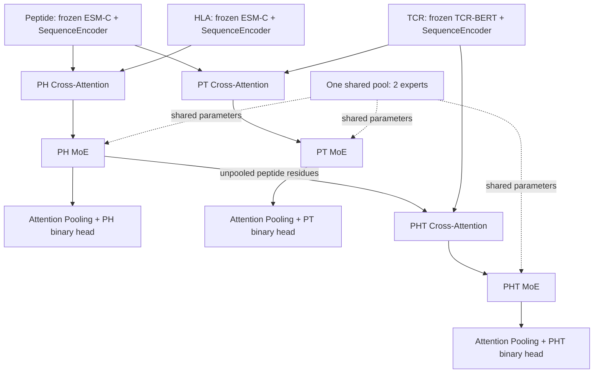

# Stage MOE：stage8 架构上的 MoE 版本一

本阶段实现《MoE模型架构优化.md》的**版本一**：复用 stage8 的三模态 SequenceEncoder 和 PH→PHT 路径，以共享/专属专家替换交互块的普通 FFN。ESM-C/TCR-BERT 使用现有预训练权重并冻结；下游网络全部独立随机初始化，不加载 stage8 checkpoint。

## 模型



- PLM 输入维度：Peptide/HLA 为 960，TCR 为 768；三个独立 SequenceEncoder 投影到 256 维，分别使用三层、8 头自注意力及 1024 维 FFN。
- 三条交互路径各有一层 pre-LN Cross-Attention 残差；交互层没有原 stage8 普通 FFN。随后执行 `U + Dropout(sum(g_j * E_j(LN(U))))`。
- 2 个共享专家只注册一次，每个分支另有 2 个专属专家，共 8 个 `256→512→256` GELU FFN，专家共 2,103,296 个参数。独立初始化，不赋予人工生物学角色。
- 每个任务有独立门控 `context→128→4`，Softmax 输出 `[B,4]`，同一样本所有肽位置共用权重。共享专家始终是前两个，专属专家是后两个。
- PH 上下文为 masked mean 的 `[U_PH, X_P, X_H]`；PT 为 `[U_PT, X_P, X_T]`；PHT 为 `[U_PHT, X_P, X_H, X_T]`。门控不使用自身 MoE 输出。
- PH MoE 的未池化结果作为 PHT 的 Query。PHT 计算不需要 PT 分支，也没有 PT→PHT 融合。
- 每任务独立 `256→128→1` 的 tanh Attention Pooling 打分器，以及 `256→128→1` GELU 二分类头。训练输出单 logit，推理使用 Sigmoid。dropout 默认统一为 0.1。
- padding 不参与上下文或池化，MoE 残差输出的 padding 位置置零。PH 推理只使用 P/H；PT 推理只使用 P/T。

主要接口位于 `source/plm_unified/stage_MOE_model.py`：

```python
model = StageMOEBindingModel(config)
ph = model('ph', peptide_hidden, peptide_mask, hla_hidden, hla_mask)
pt = model('pt', peptide_hidden, peptide_mask, tcr_hidden, tcr_mask)
pht = model.forward_triplet(peptide_hidden, peptide_mask,
                            hla_hidden, hla_mask, tcr_hidden, tcr_mask)
all_heads = model.forward_all(peptide_hidden, peptide_mask,
                             hla_hidden, hla_mask, tcr_hidden, tcr_mask)
```

结果的 `logits` 按 `ph/pt/pht` 存放 `[B]` 张量，`routing` 存放执行过的分支门控。`forward_triplet` 只产生 PHT logit，但包含 PH/PHT 的路由结果。可用 `return_attention=True` 和 `return_features=True` 返回注意力、池化权重及池化特征。

## 数据与训练

默认配置：`configs/plm_stage_MOE.yaml`。

| 数据 | 输入字段（大小写不敏感） | 唯一监督标签 |
|---|---|---|
| `dataset/PH/{train,val,test}.csv` | peptide、HLA | label → PH |
| `dataset/PT/{train,val,test}.csv` | peptide、tcr | label → PT |
| `dataset/PHT/{train,val,test}.csv` | peptide、HLA、tcr | PHT → PHT |

PHT 文件中的 PH/PT/class_code 不作为额外监督，不将 PHT 阴性推断成二元阴性。四类目录是聚合 PHT 文件的视图，不重复读取。保留 source/source_file、原始行号和 split_type；缺少阴性来源说明时不会自行推断来源。

内部 `StageMOERecord` 包含可选 H/T、三个标签及有效掩码。无标签位置为 NaN 和 false；损失先索引有效标签，再计算 BCE。具有完整输入而缺少 PH 标签的 PHT 样本仍可通过 PH 中间路径传播梯度，但不会产生 PH 分类损失。`compute_stage_MOE_loss` 可以处理 `forward_all` 与显式可信的多任务标签/掩码；默认 CSV 管线只启用原生任务标签。

审计在应用调试样本上限之前运行。相同任务的重复同标签记录去重，标签冲突或跨集合监督记录重叠报错；非法长度/非标准氨基酸序列被过滤并记录原始行号和原因，不改写 CSV。保持现有划分，不生成负样本、不重新划分数据。

默认 `train` 联合训练入口每次 optimizer step 各取 PH、PT、PHT 一个 microbatch（默认每任务 32），各自平均 BCE 后按权重相加；三个任务默认权重均为 1。依次反向传播累积梯度，仅在三个任务完成后更新一次参数。epoch 长度由最长任务 loader 决定，较短任务重新打乱循环；尾 batch 不丢弃，日志记录实际样本量。原始 PHT 训练类别比例保留为约 1:3。

新增 `train-sequential` 顺序训练入口：每轮完整遍历 PH 训练集一次，再遍历 PT 一次，最后遍历 PHT 一次。每个 batch 仅计算当前任务损失并立即更新参数，短任务不循环补齐；尾 batch 保留。一个 epoch/round 指三个任务各完成一次遍历，完成 PHT 后统一验证三个任务。早停与模型选择仍使用三任务验证 PR-AUC 均值，默认最多 100 轮、patience=10。

顺序模式沿用同一模型、优化器和学习率调度器，任务切换时不重置；学习率总步数按三个任务的 batch 数之和计算。当前任务未使用的参数没有梯度，因此不发生该步的 AdamW 更新；PHT 仍通过 PH→PHT 路径更新 PH 交互和专家。共享编码器/专家会被后续任务继续更新，不冻结先训练过的任务。该模式按原始数据量遍历，不再让三个任务拥有相同数量的更新步。

| 参数 | 默认值 |
|---|---|
| 优化器 | AdamW |
| 下游模块 / 路由器学习率 | 2e-4 / 1e-4 |
| Weight decay / 梯度裁剪 | 0.01 / 1.0 |
| 学习率调度 | 5% steps warmup，随后线性衰减 |
| 门控温度 | epoch 1–5 从 2 线性降到 1，之后固定 1 |
| 门控均衡系数 | 0；可配置 1e-3 或 1e-2 |
| 训练上限 / early stopping | 100 epochs / patience 10，min_delta 1e-4 |
| 模型选择 | PH/PT/PHT 各自验证集 PR-AUC 的算术平均 |
| 精度 / seed | CUDA bf16，CPU float32 / 42 |

均衡正则作用于每个有有效监督的分支的 batch 平均门控，目标为四专家均匀分配；PHT microbatch 不重复施加 PH 的独立正则。可观测 PH 中间路径在 PHT 上的路由统计。

本阶段没有 stage8 层级概率约束、PT implication、二元回放比例、两阶段解冻、FGM、Top-2、PCGrad 或消融运行器。

## 运行

启动脚本优先使用 `/home/mjp/miniconda3/envs/unifyimmun/bin/python`，可通过 `PYTHON_BIN` 覆盖。使用 `STAGE_MOE_CONFIG` 或 `--config` 指定 YAML。

```bash
# 全量审计，含三个任务的 train/val/test 以及 benchmark
./run_stage_MOE.sh audit --include-benchmarks

# 构建独立 frozen-PLM 残基缓存。包含测试序列仅用于冻结编码器推理，
# 训练样本、模型选择和阈值拟合仍仅使用 train/val。
./run_stage_MOE.sh cache --splits train val test --include-benchmarks

# 开始训练，输出目录须为空
./run_stage_MOE.sh train --output-dir trained_model/PLM_Stage_MOE/seed42_run1

# epoch 边界恢复（必须使用 last.pt）
./run_stage_MOE.sh resume \
  --resume trained_model/PLM_Stage_MOE/seed42_run1/last.pt

# 顺序训练：每轮 PH → PT → PHT，然后统一验证
./run_stage_MOE.sh train-sequential \
  --output-dir trained_model/PLM_Stage_MOE/seed42_sequential

# 恢复顺序训练，使用匹配的入口
./run_stage_MOE.sh resume-sequential \
  --resume trained_model/PLM_Stage_MOE/seed42_sequential/last.pt

# 测试聚合数据集
./run_stage_MOE.sh evaluate \
  --checkpoint trained_model/PLM_Stage_MOE/seed42_run1/best.pt

# 测试现有 PH/PT/PHT 的 benchmarks/test_*.csv
./run_stage_MOE.sh benchmark \
  --checkpoint trained_model/PLM_Stage_MOE/seed42_run1/best.pt
```

`cache` 默认仅缓存 train/val。已有缓存默认不覆盖；确需重建时使用 `--overwrite` 并明确选择覆盖所需的 splits。完整缓存会占用较大磁盘空间，缓存的只有 PLM 残基表示，没有训练中的投影、交互或专家输出。编码 Peptide/HLA 时复用同一份 ESM-C 实例。

默认缓存目录为 `embedding_cache/plm_stage_MOE`，输出为 `trained_model/PLM_Stage_MOE/seed_<seed>/<action>_<timestamp>`。缓存检查维度、最大长度、模态、dtype、编码器指纹及使用序列覆盖；指纹复用仓库的本地模型 fingerprint 方法，不是全部模型权重的完整 SHA256。编码器元数据随 checkpoint 保存；这不等同于已经证明 TCR-BERT 的预训练抗原监督无重叠。

小样本训练冒烟命令（前提是已构建对应缓存）：

```bash
./run_stage_MOE.sh train --device cpu --num-workers 0 \
  --limit-train-samples 64 --limit-eval-samples 64 --max-steps-per-epoch 2 \
  --output-dir trained_model/PLM_Stage_MOE/smoke
```

如只需两轮冒烟，可在独立配置中设置 `stage_MOE.max_epochs: 2`。调试样本使用固定种子随机选取；验证子集必须保留两类标签。默认缓存预计算仍覆盖所选 splits 的全部合法独立序列，不受训练调试上限影响。

顺序训练也可以直接使用 `python source/train_plm_stage_MOE_sequential.py --config configs/plm_stage_MOE.yaml`，恢复时追加 `--resume <last.pt>`。两个训练入口共用数据、缓存和 YAML。顺序模式的 `--max-steps-per-epoch N` 对每个任务分别限制为最多 N 个 batch，因此每轮最多 3N 次更新，保证调试时仍覆盖 PH/PT/PHT；未设置时各任务完整遍历。顺序训练的 best.pt 可直接用于现有 evaluate/benchmark 入口。

## 产物与恢复契约

- `audit.json`：监督来源、过滤明细、数据 SHA256、重复统计、跨任务实体重叠。benchmark 额外报告相对于所有任务训练池的严格 cold 资格。
- `config.json`、`history.json`：解析后的配置，以及每轮三任务损失、样本量、路由平均权重/熵、共享/专属比例、温度、参数量、训练吞吐和 CUDA 峰值显存。
- `swanlab.json`、`swanlog/`：SwanLab 实验 ID、在线链接和本地同步日志。仓库 YAML 默认 `swanlab.mode: online`，联合/顺序训练分别创建实验，上传每 50 个训练步的损失、学习率，以及每轮完整验证指标和路由统计。可用 `--swanlab-mode disabled` 关闭；未配置 swanlab 的旧配置与测试默认关闭。
- `best.pt`：最佳下游权重、架构配置、编码器身份、温度、三个验证集阈值及验证指标。
- `last.pt`：当前权重以及优化器、调度器、GradScaler、Python/NumPy/PyTorch/CUDA RNG、epoch、global step、early stopping、历史和最佳模型副本。
- `metrics.json`、`metrics.md`、逐数据集预测 CSV：AUROC、PR-AUC、MCC、F1、敏感度、特异度、Brier score、正负数量及比例，预测 CSV 同时包含四个专家权重。

PR-AUC 沿用仓库 `precision_recall_curve + auc`，不是 `average_precision_score`。每个任务的阈值只在验证集最大化 MCC；测试/benchmark 从 checkpoint 读取阈值，不重新调优。未定义的指标在 JSON 中写为 null。

恢复严格校验模型、训练设置、原始训练/验证数据指纹、缓存 manifest 身份与调试上限。可更换运行设备、worker 数、评估 batch size、日志频率；其他训练超参数保持一致。重新构建缓存后 manifest 改变可能使旧训练无法按原契约恢复，建议一开始将后续测试需要的序列纳入缓存。

恢复边界是完整 epoch。epoch 中途崩溃会从上一个完整 epoch 重跑；没有承诺逐 minibatch 恢复。只能加载 `stage_MOE_v1` checkpoint，不能将 stage8 checkpoint 当作本阶段模型。

顺序模式同样在完整 PH→PT→PHT 一轮结束后保存恢复点。checkpoint 记录 `training_mode=sequential` 和任务顺序，日志额外记录各任务实际更新步数。联合模式与顺序模式不能互相恢复，避免优化器和学习率调度语义不一致；旧的未记录 training_mode 的 checkpoint 按 joint 处理。

联合与顺序训练都支持 `--swanlab-mode online`。实验记录在 `unifyimmun` 项目，名称包含 joint/sequential、seed 与运行目录名；checkpoint 保存 SwanLab run ID，恢复时继续同一实验。测试使用的默认配置关闭在线上传。

## 验证记录

运行新增测试：

```bash
OMP_NUM_THREADS=1 MKL_NUM_THREADS=1 \
  /home/mjp/miniconda3/envs/unifyimmun/bin/python \
  -m unittest discover -s tests/stage_MOE -v
```

测试使用临时、真实 HDF5 缓存，不需要加载 PLM。覆盖专家共享与优化器唯一注册、手算稠密混合、单任务/all-head 一致性、输入边界、padding、梯度路径、缺失标签、数据冲突、缓存身份、三任务循环采样、epoch 恢复和命令行训练/评估。CPU 连续训练与恢复训练的权重逐项完全一致。

顺序入口另有测试验证 PH→PT→PHT 的完整 batch 顺序、逐 batch 更新、未参与分支参数不变、无短任务重复采样、各任务调试上限、精确恢复、混用模式拒绝，以及启动脚本到评估入口的闭环。

另在 RTX 4090 上以默认模型尺寸完成 bf16 三头前向、联合损失、反向和 AdamW 更新，所有参数梯度有限。默认下游模型共 11,224,978 个参数。该检查使用合成残基特征，不代表完整 PLM 缓存预计算或正式训练已经完成。

2026-10-27 对现有数据完成审计：PH/PT 无序列过滤；PHT train 的 72,192 条中保留 72,190 条，val 的 32,056 条中保留 32,055 条，test 保留全部 42,146 条。过滤明细由 audit 输出，不修改原数据。三个任务同任务 train/val/test 之间没有重复监督记录。

现有严格跨任务 cold 审计发现：`PT/benchmarks/test_unseen_tcr.csv` 有 5 个 TCR、`PHT/benchmarks/test_unseen_tcr.csv` 有 4 个 TCR 出现在任一任务训练池。它们仍按现有划分评估，但不能把整体结果称为严格跨任务 cold-TCR。检查到的 unseen-peptide 与 unseen-HLA benchmark 通过相应实体隔离检查。原聚合划分混合多个场景，不能直接视为完全 cold。

同次 stage8 回归运行 65 项，其中 60 项通过、5 项与现有代码预期不一致：旧测试期望 patience=5/max_rounds=15，当前默认是 20/100；YAML checkpoint 文件名与旧测试不同；旧 lean checkpoint 测试不接受现有 SequenceEncoder 权重。本次没有修改 stage8 或公共注意力模块来迎合这些旧断言。

仅实现版本一主模型，不能据此断言 MoE 优于等参数 FFN，或样本路由带来独立增益。正式性能结论仍需完整训练和后续对照实验。
